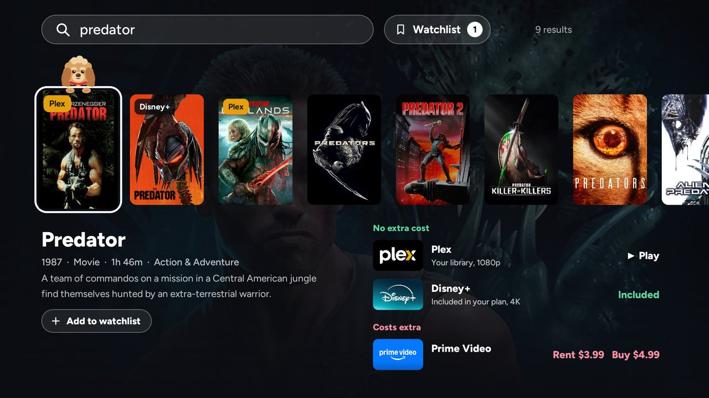
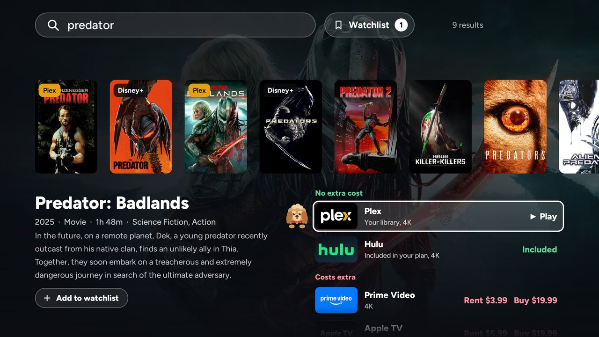
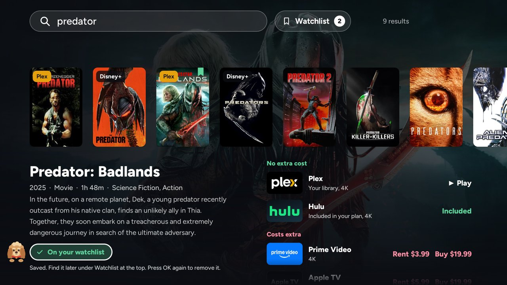
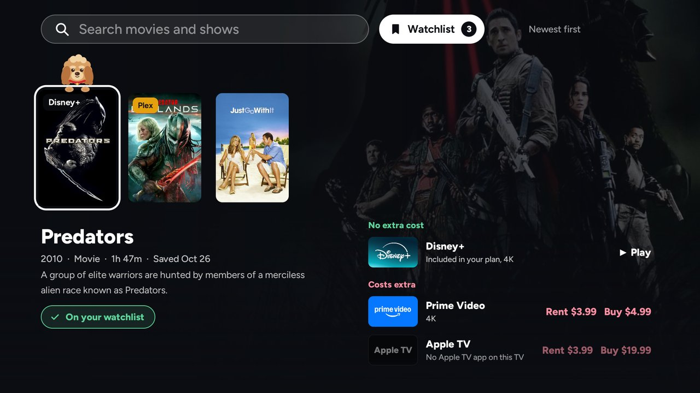

# Stella TV

**One search box for everything you can watch**: your own media library (Plex, later Jellyfin and Kodi) and the streaming services you pay for, in one list, with one press to start watching.

> Stella is the labradoodle mascot who shows you where you are on the screen.

Status: **working app for Android TV**, in daily use on an NVIDIA SHIELD TV. There's no app store version yet: you build it with your own free API keys. See [docs/SETUP.md](docs/SETUP.md).

**Works on:** NVIDIA SHIELD TV (tested). Google TV and Android TV devices should work too, but haven't been tested yet. Not Fire TV, Samsung, LG or Roku. Details in [docs/SETUP.md](docs/SETUP.md#will-it-work-on-my-tv).

**Setting it up with an AI assistant:** clone this repo, open it in Claude Code, Codex or Gemini CLI, and ask it to help you install it on your TV. [AGENTS.md](AGENTS.md) tells it how, step by step, without ever asking for your keys in the chat.

## The problem

You want to watch *Predator*. Is it in your own library? On Netflix? Hulu? Rent-only? Today you open four apps to find out.

- **Google TV search** answers this, but only with Google's launcher, ads and tracking. On a de-Googled Android TV with a custom launcher, its results can't be opened.
- **JustWatch** shows where something streams, but knows nothing about your own library. Its TV app can't be opened from another app with a search filled in.
- **Plex Discover** shows streaming availability next to your library, but only inside Plex.

## The idea

Type a title once and get one result list:

| Predator (1987) | **Your Plex**, free · Prime Video, rent $3.99 |
|---|---|
| Predator: Badlands (2025) | **Your Plex**, free · **Hulu**, included · Apple TV, rent $5.99 |
| Prey (2022) | **Hulu**, included |

Select a result and it opens straight into the right app, on the right title. Results are ranked: things you already own first, then your subscriptions, then free services, then rentals.

Found something for later? **Add to watchlist** saves it on the TV itself (no account, no Plex needed). Open Search with nothing typed, or press **Watchlist** beside the search box, to see your saved titles with up-to-date info on where each one is playing.

| | |
|---|---|
|  |  |
| *Where to watch, cheapest first: your library, then what you already pay for, then rentals* | *Save a title for later* |
|  | |
| *Your watchlist, with where each title is playing today* | |

## Documents

| Doc | What's in it |
|---|---|
| [docs/SETUP.md](docs/SETUP.md) | Set it up on your own TV, step by step |
| [docs/FINDINGS.md](docs/FINDINGS.md) | What was tested on an NVIDIA SHIELD TV, and what worked |
| [docs/DATA-SOURCES.md](docs/DATA-SOURCES.md) | APIs for streaming availability, local libraries and watch history |
| [docs/ARCHITECTURE.md](docs/ARCHITECTURE.md) | How the app and the optional caching server fit together |
| [docs/ROADMAP.md](docs/ROADMAP.md) | Prototype → personal use → possible open-source release |

## Building it

Start with [docs/SETUP.md](docs/SETUP.md). [android/README.md](android/README.md) explains the TV app's code, and [prototype/README.md](prototype/README.md) the command-line prototype it grew from.

## Secrets

API keys never go in this repo. Locally, the Streaming Availability key lives at `~/.config/streaming-api/key` (mode 600). See [docs/ARCHITECTURE.md](docs/ARCHITECTURE.md#secrets).

## License

Copyright 2026 Anand Sheth. Licensed under the [Apache License, Version 2.0](LICENSE).

The Figtree font in `android/app/src/main/assets` is under the SIL Open Font License ([android/FONT-LICENSE-OFL.txt](android/FONT-LICENSE-OFL.txt)). Streaming data comes from the Streaming Availability API and title data from TMDB, each under its own terms. This product uses the TMDB API but is not endorsed or certified by TMDB.
